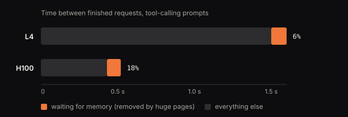

# Huge pages for the llama.cpp server: technical report

The full measurements behind the blog post [One environment variable made our llama.cpp server up to 21% faster](https://tensward.com/blog/huge-pages-llama-cpp). Tensward, November 2026.

## Summary

The llama.cpp server was waiting for the operating system to hand out memory, 4 KB at a time.

```
GLIBC_TUNABLES=glibc.malloc.hugetlb=1 llama-server -m model.gguf ...
```

That line gave a llama.cpp server between 3.5% and 21% more requests per second, and in three of the four setups below a first token that arrives about a fifth sooner. We tested it on Qwen3.8-27B, which is one of the most used models in local AI. No code change, no rebuild, no root for the variable.

## What the server was waiting for

We build Tensward, an open-source tool that measures and tunes LLM inference. On one test (H100, tool-calling prompts) the GPU was doing real work less than half the time, and `nvidia-smi` could not say why.

llama.cpp's server remembers conversations. After it reads a prompt, it saves a snapshot of the model's state into ordinary RAM, so a later request that starts the same way can skip that work. For the 27B model we tested, that is about three snapshots of about 150 MB per request in our tool-calling test (1.3 in the chat test).

Each snapshot goes into brand-new memory. The operating system hands out new memory in blocks of 4 KB. The first time a program writes into a block, the kernel pauses the program briefly to set that block up. That pause is a page fault. We counted them: **about 124,000 page faults per request** in the tool-calling test on the L4 (145,000 on the H100). The chat test made fewer snapshots and about 87,000 faults, so snapshots are not the only fresh memory there.

The same thread that keeps the GPU fed also writes the snapshots. While it waits for memory, the GPU idles.

## The fix

Linux can hand out memory in 2 MB pieces instead, called huge pages. On many systems it only does so when a program asks. The variable above makes the server ask.

You can see the effect without any model. Writing to 8 GiB of fresh memory for the first time took 4.8 seconds the normal way and 1.7 seconds with the variable, on four machines.

In the server, page faults fell from about 124,000 to about 1,850 per request, and on the L4 one snapshot took 46 ms instead of 80 ms.

## Results

Qwen3.8-27B (Q4_K_M) on llama.cpp, default settings, only the variable different. Every number is the average of paired runs, with a fresh server for every run. First-token times are for text replies.

| Setup | Build | Requests per second | First token, median | First token, slowest 5% |
|---|---|---|---|---|
| H100, tool-calling prompts, 16 users | b12246 | +21% | 22% sooner | 34% sooner |
| H100, plain chat, 16 users | b12246 | +14% | 19% sooner | 34% sooner |
| L4, tool-calling prompts, 8 users | b12441 | +6.5% | no clear change | 21% sooner |
| L4, plain chat, 8 users | b12441 | +3.5% | 22% sooner | about 24% sooner |

On other L4 machines with tool-calling prompts the gain was 6.9% (b12246), 9.2% and 10.9% (b12441).

**The first token improved even where throughput barely moved.** On the L4 with plain chat, throughput rose 3.5%, but the first word arrived in 1.7 seconds instead of 2.2.

**At lower load the first token gained more.** On the L4 with tool-calling prompts at half load (4 users instead of 8), the median first token was 17% sooner and the slowest 5% about a quarter sooner.

## Why a faster card gains more

The wait for memory happens on the CPU, so it costs roughly the same whatever GPU you have: about 0.1 to 0.15 seconds per request in our tests. What changes is everything else. The H100 finishes about three times as many requests per second as the L4, so the same wait is a much bigger share of its time.



With tool-calling prompts, the server finished a request every 1.60 seconds on the L4 and every 0.52 seconds on the H100. Huge pages took 0.10 seconds off the first and 0.09 seconds off the second. That is 6% on the L4 and 18% on the H100.

So the faster your GPU, the more a fixed cost on the CPU side matters. This is two cards, with different numbers of users and llama.cpp builds a few days apart, so read it as the pattern we saw, not a law.

## When it helps, and when it does not

It does not help every setup. It helped where the server saves a lot of state:

- llama.cpp with the 27B model, on both cards, with tool-calling prompts, chat and returning conversations.
- Ollama with the same model. Ollama runs llama.cpp inside. It gained between 1.7% and 7.1% across three machines, two of the three clearly above zero. We do not know yet what differs between machines.

It did nothing we could measure here:

- An 8B model in a plain chat test on an L4, on llama.cpp and on Ollama. That model makes about 5,500 page faults per request, far fewer than the 27B. With users returning to their own conversation, the 8B did gain: +8.8% on the H100 and +3.1% on the L4 (older build).
- vLLM and SGLang with an 8B model on an L4. They make almost no page faults per request (12 and fewer than 1). vLLM's default already maps a few MB of huge pages. In one earlier test with a very small model on an H100, vLLM gained about 4%.

## Cost

What we saw, with the variable:

- llama.cpp memory use stayed within noise (within 0.2 GB). vLLM used 0.16 GB more and SGLang 0.12 GB more.
- Ollama with the 27B used 0.5 GB more on average, and one run 1.2 GB more. We did not resolve this. It also used about 0.15 of a CPU core more.
- GPU memory and start-up time on a fresh machine were unchanged.
- Answers matched the default about as often as two default runs match each other (within a margin of 0.1). For vLLM, 52% were identical to the default's, against 61% between two default runs.
- No request failed.
- For the 8B, the slowest-request numbers were too noisy to rule out a small loss.

## Robustness

We also tried to break it. We started the server on a machine whose free memory we had chopped into small pieces just before launch (start-up then compacted part of it). The gain was still there (+7.8% requests per second, four paired runs) and no first token took more than twice as long as in the default runs. In two runs of about half an hour, the gain was about the same in the second ten minutes as in the first (+8.9% then +8.3%; +9.0% then +8.8%).

## The limits

- **The gain depends on the machine.** On rented L4 machines of the same type, llama.cpp gained between 6.5% and 11%, and Ollama between 1.7% and 7.1%.
- **One model.** The big gains are on Qwen3.8-27B. We have not tested other models like it.
- **Fragmented memory.** On a machine whose memory is badly fragmented, loading took 76 to 117 s instead of 74.5 s, with or without the variable. We cannot say if the variable adds to it.
- **Half an hour is not a week.** Our longest runs are about 30 minutes. We know nothing about memory growth over days.
- **The snapshots explain only part of the first-token gain.**
- It needs glibc 2.35 or newer, and a system that allows huge pages.

## Try it yourself

Check the huge-page mode. You want `madvise` or `always`, not `never` (changing it needs root):

```
cat /sys/kernel/mm/transparent_hugepage/enabled
```

Check glibc (2.35 or newer; Ubuntu 22.04, Debian 12 or later):

```
ldd --version
```

Start the server with the variable:

```
GLIBC_TUNABLES=glibc.malloc.hugetlb=1 llama-server -m model.gguf -np 8 ...
```

For Ollama started by hand, set it on the server process:

```
GLIBC_TUNABLES=glibc.malloc.hugetlb=1 ollama serve
```

If a service manager runs Ollama, set the variable in the service's environment instead, for example with a systemd override. We did not test that route. In our runs of Ollama 0.40.16 the variable reached the process that runs the model, named `llama-server`. On other versions, find the process that holds the model.

Under load, check that it took effect. This number should be well above zero:

```
grep AnonHugePages /proc/$(pidof -s llama-server)/smaps_rollup
```

Run the checks as the server's user, or with sudo. `pidof -s` returns one process, so it fits a single server.

Then measure. Run the same load with and without the variable, a few times each, alternating, and compare requests per second and first-token time. Count page faults too. The number is a running total, so read it before and after the load and subtract:

```
ps -o min_flt= -p $(pidof -s llama-server)
```

If the count barely grows under load, you do not have this problem. We did not test containers; the huge-page mode belongs to the host.

## How we measured

- llama.cpp b12246 (H100 rows) and b12441 (L4 rows), all layers on the GPU, default cache settings. Ollama 0.40.16, vLLM 0.33.0, SGLang 0.5.21.
- Each run is 100 to 192 requests from a closed-loop client: each user sends the next request when the last one ends. The half-hour runs have about 1,200 requests and the vLLM and SGLang runs 512. Four to eight paired runs per row. Tool-call replies arrive in one piece and are left out of the first-token columns.
- Ubuntu, glibc 2.39, mode `madvise`, freshly started cloud machines except where noted.

## How we found it, and prior work

We saw it with the census, the small profiling library we wrote about in [an earlier post](https://tensward.com/blog/gpu-busy-doing-what). It records every kernel and copy on the GPU. The gaps lined up with the snapshots, and counting page faults did the rest.

Huge pages are not new for llama.cpp: there are requests and patches for model weights and CPU decoding ([#2251](https://github.com/ggml-org/llama.cpp/issues/2251), [#22022](https://github.com/ggml-org/llama.cpp/issues/22022), [#27478](https://github.com/ggml-org/llama.cpp/pull/27478)). A stall in the snapshot was reported in October ([#30252](https://github.com/ggml-org/llama.cpp/issues/30252)), and three changes since made it much cheaper ([#30881](https://github.com/ggml-org/llama.cpp/pull/30881), [#31391](https://github.com/ggml-org/llama.cpp/pull/31391), [#30137](https://github.com/ggml-org/llama.cpp/pull/30137)). Our builds include them.

We were not the first to see the page faults. Two llama.cpp forks changed the server itself to ask for huge pages for these buffers: [Piggidragon/llama.cpp #23](https://github.com/Piggidragon/llama.cpp/pull/23) in October, on the same 27B model with two consumer cards, noting that "faulting a fresh 150 MB buffer in 4 KiB pages took longer than the copy itself", and [llama-cpp-rdna-boosts #248](https://github.com/stew675/llama-cpp-rdna-boosts/pull/248) for the prompt cache on AMD cards. Neither change is in upstream llama.cpp. What this report adds is a way to get the same effect on stock llama.cpp and Ollama without touching code, and what it does to throughput and first token on two cards, including where it does nothing.
